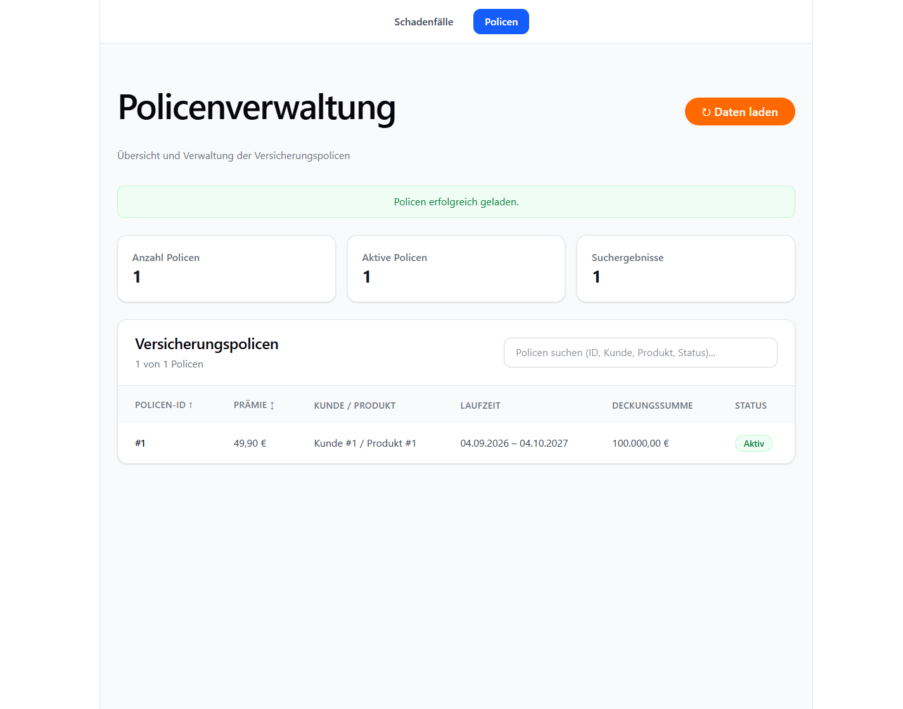
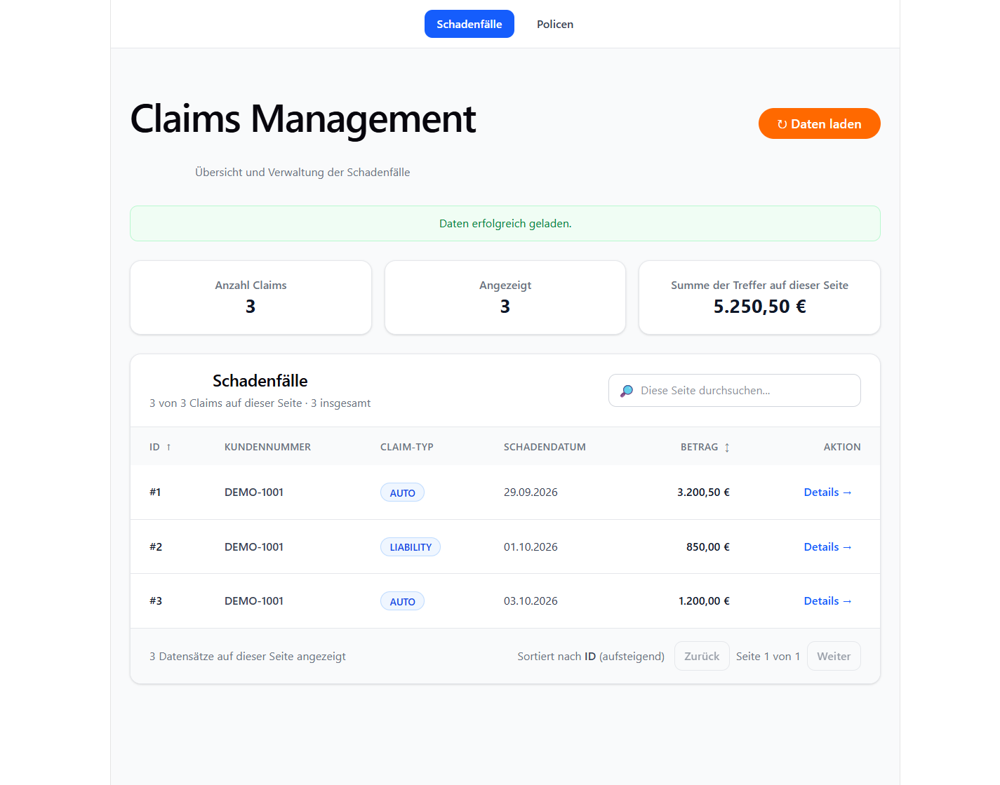

# Insurance Platform

<table>
  <tr>
    <td align="center">
      
      <sub>Policenübersicht</sub>
    </td>
    <td align="center">
      
      <sub>Schadenfall-Dashboard</sub>
    </td>
  </tr>
</table>

Portfolio-Projekt für die digitale Abbildung ausgewählter Versicherungsprozesse.
Das Monorepo verbindet ein Spring-Boot-Backend (modularer Monolith) mit einem
React-Frontend.

**Live-Demo:** <https://insurance.hunarkarim.de> ·
[Swagger UI](https://insurance.hunarkarim.de/swagger-ui.html) ·
Demo-Zugänge: `customer`/`customer`, `clerk`/`clerk`, `admin`/`admin`

## Funktionen

- Kunden und Versicherungsprodukte anlegen und abrufen
- Policen ausstellen, anzeigen und mit Wirksamkeitsdatum stornieren; die
  Prämie für den nicht mehr gedeckten Zeitraum wird anteilig gutgeschrieben
- Schäden melden, paginiert abrufen und durch die Statusmaschine führen
  (eingegangen → in Prüfung → genehmigt/abgelehnt)
- Genehmigung mit Deckungsprüfung nach dem **Schadenereignisprinzip**,
  Deckungssumme je Schaden und **Jahreshöchstleistung** je Versicherungsjahr
- Rechnungen und Auszahlungen automatisch über Domänenereignisse mit
  **persistenter Outbox**; Admins führen Auszahlungen aus
- Rollen (Kunde, Sachbearbeitung, Admin), **Eigentumsprüfung** für Kunden,
  Rate-Limit, Audit-Trail und **Idempotency-Key** gegen doppelte Meldungen

Die Weboberfläche zeigt Schadenfälle und Policen, bietet Login mit
Demo-Zugängen, Schadenmeldung, Statuswechsel für Schadenfälle und
Policenstornierung. Alle weiteren Funktionen sind
über die REST-API und Swagger verfügbar. Das Projekt ist eine Portfolio-Demo,
keine produktionsfertige Versicherungsplattform.

## Tech-Stack

| Bereich             | Technologien                                                                  |
| ------------------- | ----------------------------------------------------------------------------- |
| Backend             | Java 21, Spring Boot 3.5, Spring Data JPA, Hibernate, Spring Modulith 1.4     |
| API und Sicherheit  | REST, OpenAPI/Swagger, Bean Validation, Spring Security (HTTP Basic, Rollen)  |
| Datenbanken         | PostgreSQL 15 mit Flyway; H2 für schnelle lokale Entwicklung                  |
| Frontend            | React 19, TypeScript, Vite, Tailwind CSS                                      |
| Qualitätssicherung  | JUnit, Mockito, Testcontainers, Awaitility, Vitest, Testing Library, ESLint, Prettier |
| Betrieb             | Docker, Docker Compose, Caddy, Actuator, GitHub Actions                       |

## Architektur

Das Backend ist ein modularer Monolith: Kunden, Produkte, Underwriting,
Policen, Schäden, Billing und Audit sind Spring-Module mit geprüften Grenzen.
Module rufen einander nur über veröffentlichte APIs auf; Billing reagiert auf
Ereignisse, die mit der fachlichen Änderung in einer Outbox gespeichert werden.

- [Architektur-Kurzüberblick](docs/architecture.md)
- [Technische Dokumentation](docs/architecture/technical-documentation.md)
- [Architekturprinzipien](docs/architecture/architecture-principles.md)
- [Roadmap und offene Punkte](docs/architecture/architecture-roadmap.md)
- [API-Dokumentation](docs/api/README.md)
- [Betrieb: Backup, Demodaten-Reset, PostgreSQL-Upgrade](docs/operations.md)
- [Architekturentscheidungen (ADRs)](docs/README.md#architekturentscheidungen-adrs)

## Voraussetzungen

- Java 21
- Node.js 22 oder neuer und npm
- Docker Desktop (optional, für PostgreSQL und den PostgreSQL-Integrationstest)

## Lokal starten

Frontend-Abhängigkeiten einmalig installieren:

```powershell
npm ci --prefix frontend
```

Backend mit dem Standardprofil `dev` (eingebettetes H2) starten:

```powershell
.\backend\mvnw.cmd -f backend\pom.xml spring-boot:run
```

Unter macOS/Linux: `bash backend/mvnw -f backend/pom.xml spring-boot:run`.

In einem zweiten Terminal das Frontend starten:

```powershell
npm run dev
```

Das Frontend läuft unter <http://localhost:5173>, Swagger unter
<http://localhost:8080/swagger-ui.html>. Vite leitet `/api` an das Backend
weiter.

Das Profil `dev` legt bei jedem Start 50 synthetische Kunden mit Policen,
Schadenfällen und Abrechnungen neu an; die H2-Datenbank ist flüchtig. Namen
sind erfunden, E-Mail-Adressen verwenden die reservierte Domain `.test`. Bei
laufendem Backend ist H2 über TCP-Port `9123` erreichbar
(`jdbc:h2:tcp://localhost:9123/mem:insurance`), z. B. für IntelliJ Database
Tools.

### Mit PostgreSQL

```powershell
docker compose up --build
```

Compose startet PostgreSQL 15 und das Backend mit dem Profil `local`; Flyway
legt das Schema an und lädt die Demodaten (Migration `V10`). Das Frontend
startet weiterhin separat mit `npm run dev`. Die Daten liegen im Volume
`insurance-postgres15-data`. Herunterfahren mit `docker compose down`.

## Zugriff und Rollen

Lesende Aufrufe sind öffentlich, schreibende erfordern einen Demo-Zugang. Im
Frontend meldet man sich oben rechts über **Anmelden** mit einem Klick an, in
Swagger über **Authorize**. Standardmäßig ist das Passwort gleich dem
Benutzernamen.

| Aktion                                                   | Berechtigung                 |
| -------------------------------------------------------- | ---------------------------- |
| Policen, Claims, Produkte, Auszahlungen lesen            | öffentlich                   |
| Schaden melden (`POST /api/claims`)                      | `CUSTOMER`, `CLERK`, `ADMIN` |
| Claim-Status ändern, Police ausstellen/stornieren        | `CLERK`, `ADMIN`             |
| Kunden auflisten/anlegen, Underwriting-Prüfung           | `CLERK`, `ADMIN`             |
| Produkt anlegen, Auszahlung ausführen, Audit-Trail lesen | `ADMIN`                      |
| `DELETE /api/**`                                         | gesperrt                     |

Der Login `customer` steht für den Demo-Kunden `DEMO-1001` und darf Schäden nur
für dessen Policen melden; fremde Policen ergeben `403`. Ohne Anmeldung antwortet
die API mit `401`, mit unzureichender Rolle mit `403`. Je Client-IP sind pro
Minute 30 schreibende und 300 lesende Anfragen erlaubt, darüber `429`.

Da die Zugänge öffentlich sind, darf die Umgebung nur synthetische Daten
enthalten.

## Qualitätssicherung

```powershell
npm run lint
npm run format:check
npm run test:frontend   # Vitest + Testing Library
npm run build           # inklusive Typprüfung (tsc -b)
npm run test:backend
```

`npm run test:backend` ist für PowerShell/Windows eingerichtet; unter
macOS/Linux `bash backend/mvnw -f backend/pom.xml test`. Der
PostgreSQL-Integrationstest benötigt Docker und wird lokal ohne Docker
übersprungen, in der CI nie.

Die CI prüft bei jedem Pull Request Frontend (Lint, Format, Tests, Build mit
Typprüfung), Backend (`mvn verify` inklusive PostgreSQL) und baut und startet
das Backend-Image. Ein Push auf `main` deployt nur nach grüner CI.

## Deployment

Ein Push auf `main` startet **Build & Deploy**: Zuerst läuft die CI, danach
werden Backend- und Caddy-Image (amd64/arm64) gebaut, in die GitHub Container
Registry geschoben und per SSH auf dem Server gestartet. Das Caddy-Image enthält
das gebaute Frontend, liefert es aus und leitet `/api`, Swagger und OpenAPI an
das Backend weiter. Nur Caddy veröffentlicht Ports; Datenbank und Backend
liegen in internen Netzwerken. Caddy startet erst, wenn das Backend über seinen
Healthcheck bereit meldet. Zwei Deployments laufen nie gleichzeitig.

**Server vorbereiten:** Docker Compose installieren und dieses Repository nach
`~/insurance-platform` klonen (Branch `main`, `git fetch` muss möglich sein).
Jedes Deployment nutzt einen temporären Worktree des deployten Commits, lokale
Änderungen im Server-Klon stören also nicht. Compose verwendet den festen
Projektnamen `insurance-platform`, damit das PostgreSQL-Volume erhalten bleibt.

DNS-A/AAAA-Einträge der Domain auf den Server zeigen lassen und TCP `80`/`443`
sowie UDP `443` (HTTP/3) freigeben. Vor dem ersten Deployment
`~/insurance-platform/.env` anlegen:

```dotenv
DOMAIN=app.example.com
POSTGRES_PASSWORD=replace-with-a-long-random-password
# Optional: Demo-Passwörter (Standard: Passwort = Benutzername)
# DEMO_ADMIN_PASSWORD=admin
# Optional: Demo-Zugänge in Swagger und Frontend ausblenden
# DEMO_PUBLISH_CREDENTIALS=false
# Optional: Rate-Limit je Client-IP und Minute
# RATE_LIMIT_WRITES_PER_MINUTE=30
# RATE_LIMIT_READS_PER_MINUTE=300
```

`IMAGE_PREFIX` und `IMAGE_TAG` setzt der Workflow selbst; in der `.env` nur
angeben, um Images aus einer anderen Registry oder einen festen Tag zu
verwenden.

**GitHub-Secrets** unter *Settings → Secrets and variables → Actions*:
`SSH_HOST`, `SSH_USER`, `SSH_KEY`, optional `SSH_PORT` (Standard `22`). Für den
Zugriff auf GHCR nutzt der Workflow `GITHUB_TOKEN`; das Paket muss für das
Repository lesbar sein. Caddy holt und erneuert HTTPS-Zertifikate automatisch.

**Demodaten wiederherstellen:** `ops/reset-demo-data.sh --yes` (mit Backup
vorab, in einer Transaktion, nie automatisch); Details, Backup und Restore in
der [Betriebsanleitung](docs/operations.md). `dev-data.sql` nicht direkt auf
eine befüllte Datenbank anwenden – die Kunden-Einfügung ist nicht wiederholbar.

Das PostgreSQL-Volume nicht mit `docker compose down -v` löschen; gelöschte
Daten lassen sich nur aus einem Backup wiederherstellen.

**Diagnose:** `docker compose -f docker-compose.prod.yml ps` zeigt den
Health-Status, `docker compose -f docker-compose.prod.yml logs backend` die
Logs (eine JSON-Zeile pro Eintrag).

## API-Beispiele

```text
GET   /api/claims?page=0&size=20
GET   /api/claims?page=0&size=20&policyId=12345
PATCH /api/claims/4712/status?newStatus=IN_REVIEW
POST  /api/policies/12/cancel?effectiveOn=2026-12-31
GET   /api/credit-notes?page=0&size=20
```

Alle Listen sind 0-basiert paginiert, standardmäßig 20 und höchstens 100
Einträge pro Seite. `POST`-Requests können einen `Idempotency-Key` mitsenden,
damit eine Wiederholung nach einem Timeout nichts doppelt anlegt. Alle
Endpunkte und Schemata stehen in Swagger.

## Projektstruktur

```text
backend/    Spring-Boot-Anwendung, Tests und Flyway-Migrationen
frontend/   React-/TypeScript-Anwendung (Caddy-Image: frontend/Dockerfile)
docs/       Architektur, API, ADRs, Diagramme, Betrieb
ops/        Skripte für den Server (Demodaten-Reset)
.github/    CI/CD-Workflows und Copilot-Anweisungen
```
