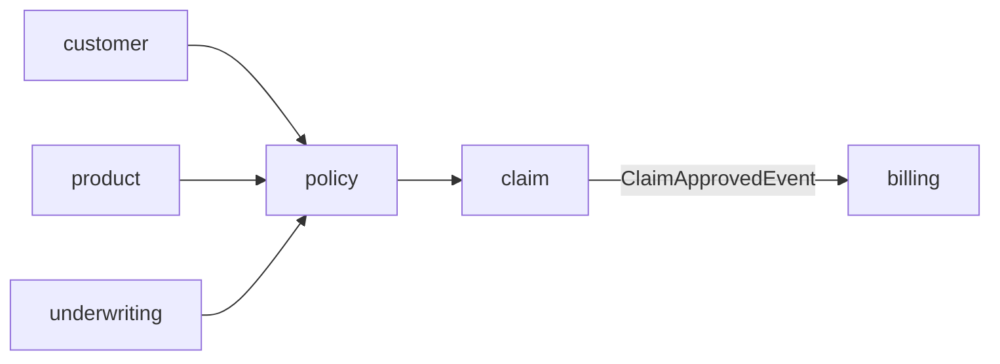

# Architektur

Die Anwendung ist ein modularer Monolith. Jede Fachdomäne besitzt ein eigenes
Spring-Modul. Benötigte synchrone Modulaufrufe laufen über veröffentlichte
`XxxApi`-Verträge; fachliche Rückmeldungen werden als Events veröffentlicht.

Der Claim-zu-Payout-Ablauf ist bewusst einseitig: `claim.application.ClaimService`
publiziert `ClaimApprovedEvent`, der Billing-Listener erzeugt idempotent eine Auszahlung.
Die Architekturprüfung in `ModularityTest` verhindert neue Zyklen und Zugriffe
auf nicht veröffentlichte Modulklassen.

Die Fachmodule verwenden eine pragmatische Schichtung: `application` koordiniert
Anwendungsfälle, `domain` enthält Fachmodelle und Spring-Data-Repositories,
`controller` bildet den HTTP-Einstieg. Unbenutzte Schnittstellen und reine
Weiterleitungs-Schichten werden vermieden.

## Lokale Profile

Das Standardprofil `dev` verwendet eine eingebettete H2-Datenbank und Hibernate
zur schnellen Entwicklung. Das Profil `local` verwendet PostgreSQL und Flyway;
die Migrationen liegen unter `backend/src/main/resources/db/migration`.
