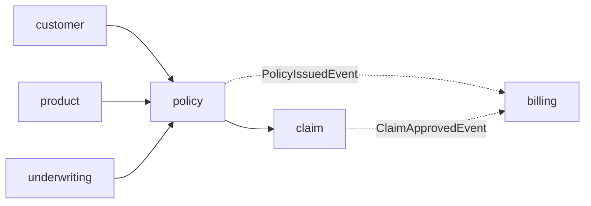

# Architektur

Die verbindliche Arbeitsgrundlage für DDD-Prinzipien, Modulgrenzen,
Klassenplatzierung und bewusste Abstraktionsentscheidungen steht in
[Architekturprinzipien und Klassenplatzierung](architecture/architecture-principles.md).
Sie beschreibt die aktuelle pragmatische Architektur und schreibt keine strikt
hexagonale Schichtenstruktur vor. Akzeptierte [ADRs](adr) bleiben maßgeblich.
Die ausführliche Beschreibung steht in der
[technischen Dokumentation](architecture/technical-documentation.md).

Die Anwendung ist ein modularer Monolith. Jede Fachdomäne besitzt ein eigenes
Spring-Modul. Benötigte synchrone Modulaufrufe laufen über veröffentlichte
`XxxApi`-Verträge; fachliche Rückmeldungen werden als Events veröffentlicht.

Der Claim-zu-Payout-Ablauf ist bewusst einseitig: `claim.application.ClaimService`
publiziert `ClaimApprovedEvent`, der Billing-Listener erzeugt idempotent eine
Auszahlung. Events werden in derselben Transaktion in einer Outbox gespeichert
und bei Fehlern erneut zugestellt
([ADR 0002](adr/0002-spring-modulith-events-outbox.md)). Die Architekturprüfung
in `ModularityTest` verhindert neue Zyklen und Zugriffe auf nicht
veröffentlichte Modulklassen.

Die Fachmodule verwenden eine pragmatische Schichtung: `application` koordiniert
Anwendungsfälle, `domain` enthält Fachmodelle und Spring-Data-Repositories,
`controller` bildet den HTTP-Einstieg. Unbenutzte Schnittstellen und reine
Weiterleitungs-Schichten werden vermieden. DDD wird für tatsächliche
Fachinvarianten eingesetzt, etwa in `Claim.approve` und `Policy.covers`
([ADR 0005](adr/0005-deckungsregeln.md)); Clean Architecture bedeutet hier vor
allem klare Verantwortlichkeiten und Modulverträge, nicht die Pflicht zu
zusätzlichen Repository-Ports und Adaptern.

## Sicherheit in Kürze

Lesende Endpunkte sind öffentlich, schreibende erfordern einen Demo-Zugang mit
passender Rolle. Kunden dürfen nur für eigene Policen handeln; ein Rate-Limit
begrenzt Anfragen je Client-IP. Details in Abschnitt 9 der
[technischen Dokumentation](architecture/technical-documentation.md#9-sicherheit).

## Profile

Das Standardprofil `dev` verwendet eine eingebettete H2-Datenbank ohne Flyway
zur schnellen Entwicklung. Die Profile `local` und `prod` verwenden
PostgreSQL 15 und Flyway; die Migrationen liegen unter
`backend/src/main/resources/db/migration` und werden in der CI gegen
PostgreSQL geprüft.
