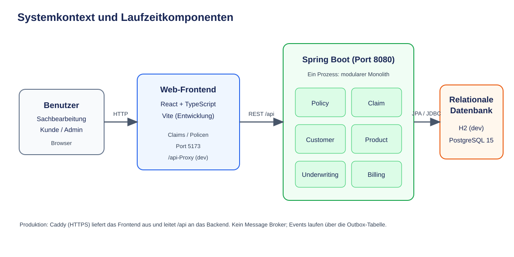
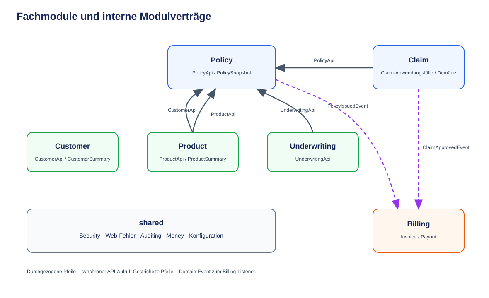
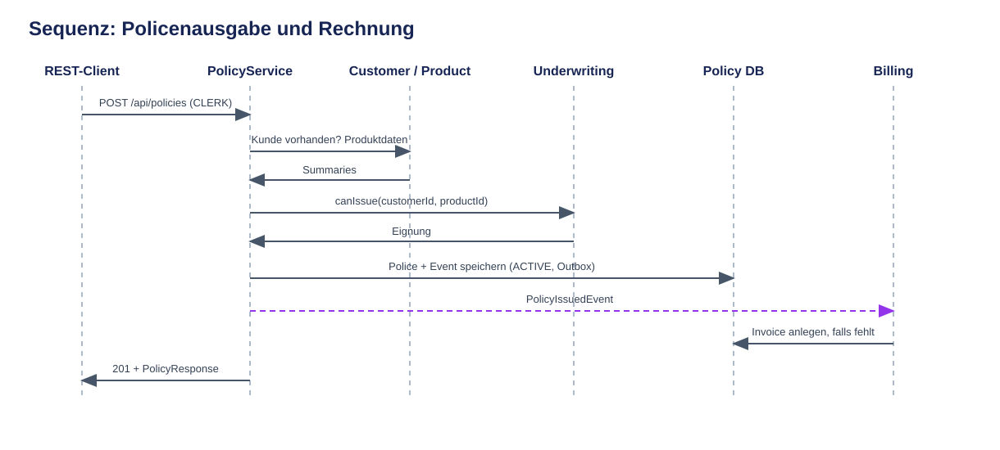
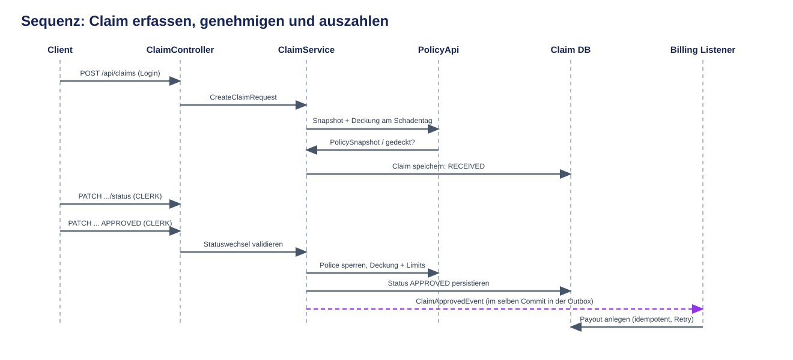

# Insurance Platform

## Technische Architektur- und Schnittstellendokumentation

**Dokumenttyp:** System- und Entwicklerdokumentation
**Zuletzt geprüft:** 13. November 2026 (inkl. PR #13–#18)
**Geltungsbereich:** Implementierter Code auf `main` zum Prüfzeitpunkt
**Status:** Bestandsaufnahme; der Code ist bei Abweichungen maßgeblich

> Die gehostete Umgebung ist eine **öffentliche Portfolio-Demo** mit
> veröffentlichten Demo-Zugängen und synthetischen Daten. Für Platzierung und
> Architekturregeln ist ergänzend
> [Architekturprinzipien und Klassenplatzierung](architecture-principles.md)
> maßgeblich; akzeptierte [ADRs](../adr) bleiben Entscheidungen. Offene Punkte
> stehen in der [Architektur-Roadmap](architecture-roadmap.md).

## 1. Zweck und Leseschlüssel

Diese Dokumentation erklärt Systemaufbau, Modulgrenzen, interne und externe
Schnittstellen, die wichtigsten Abläufe, Sicherheit sowie Betrieb.

| Zeichen  | Bedeutung                                              |
| -------- | ------------------------------------------------------ |
| `-->`    | synchroner Aufruf / Datenfluss                         |
| `-.->`   | ereignisbasierte Kopplung über die Outbox               |
| `API`    | expliziter Modulvertrag innerhalb des Java-Prozesses   |
| `REST`   | HTTP-Schnittstelle zwischen Browser/Client und Backend |

Die Diagramme liegen als SVG unter [`diagrams/`](diagrams) und zeigen
Systemgrenzen, nicht jede Klasse.

## 2. Zusammenfassung

Die Insurance Platform ist ein **modularer Monolith**: ein Spring-Boot-Prozess
mit fachlichen Modulen und einer PostgreSQL-Datenbank. Das React-Frontend wird
in Produktion von Caddy ausgeliefert, das auch `/api` an das Backend weiterleitet.

Wichtigste Prozesskette:

1. Eine Sachbearbeitung stellt eine Police aus; Kunde, Produkt und Underwriting
   werden geprüft. `PolicyIssuedEvent` erzeugt im Billing genau eine Rechnung.
2. Ein Kunde oder die Sachbearbeitung meldet einen Schaden zu einer Police.
   Geprüft werden Eigentum, Schadendatum und Deckung am Schadentag.
3. Die Sachbearbeitung führt den Claim durch die Statusmaschine.
4. Bei Genehmigung prüft das Claim-Aggregat Deckungssumme und
   Jahreshöchstleistung; `ClaimApprovedEvent` erzeugt genau eine Auszahlung.
5. Ein Admin markiert die Auszahlung als ausgeführt.
6. Wird eine Police storniert, schreibt Billing die Prämie für den nicht mehr
   gedeckten Zeitraum anteilig gut.

Ereignisse werden in derselben Transaktion wie die fachliche Änderung in einer
**Outbox** gespeichert und bei Fehlern erneut zugestellt
([ADR 0002](../adr/0002-spring-modulith-events-outbox.md)).

## 3. Systemkontext und Laufzeitkomponenten



| Komponente            | Verantwortung                                                      | Schnittstelle                          |
| --------------------- | ------------------------------------------------------------------ | -------------------------------------- |
| Browser               | Claims- und Policenübersicht, Login, Schaden melden, Statuswechsel, Storno | HTTPS                                  |
| Caddy (Produktion)    | TLS, Auslieferung des Frontends, Reverse Proxy für `/api`, Swagger | Ports 80/443                           |
| Vite (Entwicklung)    | Dev-Server, leitet `/api` an das Backend weiter                    | Port 5173                              |
| Spring-Boot-Anwendung | REST, Geschäftsregeln, Modulkommunikation, Persistenz, Outbox       | Port 8080 (in Produktion nur intern)   |
| PostgreSQL 15         | Datenbank für `local`, `prod` und Integrationstests                 | JDBC                                   |
| H2                    | In-Memory-Datenbank des Standardprofils `dev`                      | `jdbc:h2:mem:insurance`                |

Alle Fachmodule laufen in **einem** Java-Prozess. Es gibt keine separat
deploybaren Fachservices und keinen Message Broker.

### 3.1 Technologien

| Bereich            | Technologie                                                              |
| ------------------ | ------------------------------------------------------------------------ |
| Backend            | Java 21, Spring Boot 3.5.6, Spring MVC, Spring Data JPA, Hibernate       |
| Modularchitektur   | Spring Modulith 1.4.4 inkl. JPA Event Publication Registry (Outbox)      |
| Sicherheit         | Spring Security (HTTP Basic, Methoden-Security), eigener Rate-Limiter    |
| Persistenz         | PostgreSQL 15 mit Flyway; H2 im Profil `dev`                              |
| API-Beschreibung   | springdoc-openapi 2.8.13, Swagger UI                                     |
| Betrieb            | Spring Boot Actuator (Health), strukturierte JSON-Logs (ECS) in `prod`    |
| Frontend           | Vitest: Login-Speicher, Fehlermeldungen, Claim-Aktionen, Schaden melden (eigene Policen, Idempotency-Key), Storno |
| Tests              | JUnit 5, Mockito, Spring Modulith Test, Testcontainers 1.21, Awaitility, Vitest 4, Testing Library |
| API-Typen          | OpenAPI-Vertrag aus dem Backend, TypeScript-Typen per openapi-typescript 7.13 |
| Auslieferung       | Docker, Docker Compose, Caddy, GitHub Actions, GitHub Container Registry |

## 4. Backend-Architektur

### 4.1 Architekturstil

Ein Controller übersetzt HTTP in DTOs und ruft einen Anwendungsservice des
eigenen Moduls. Services koordinieren Modul-APIs, Persistenz, Audit und Events;
fachliche Invarianten liegen in den Domänenobjekten (`Claim`, `Policy`,
`Payout`, `Money`). Repositories liegen nach
[ADR 0003](../adr/0003-persistenzzugriff-im-domain-modul.md) im `domain`-Paket
des jeweiligen Moduls.



`ModularityTest` prüft mit Spring Modulith, dass Module nur veröffentlichte
Verträge anderer Module verwenden und keine Zyklen entstehen.

### 4.2 Module

| Modul          | Zuständigkeit                                                                 | Veröffentlicht                                        |
| -------------- | ----------------------------------------------------------------------------- | ----------------------------------------------------- |
| `customer`     | Kundenstammdaten                                                              | `CustomerApi`, `CustomerSummary`                      |
| `product`      | Produktkatalog inkl. Deckungssumme und Jahreshöchstleistungs-Faktor           | `ProductApi`, `ProductSummary`                        |
| `underwriting` | Ausgabeberechtigung (Kunde existiert, Produkt aktiv)                           | `UnderwritingApi`                                     |
| `policy`       | Ausgabe, Stornierung mit Wirksamkeitsdatum, Deckung, Versicherungsjahre        | `PolicyApi`, `PolicySnapshot`, `PolicyYear`, `PolicyIssuedEvent`, `PolicyCancelledEvent` |
| `claim`        | Schadenmeldung, Eigentumsprüfung, Statusmaschine, Genehmigungsregeln          | `ClaimApprovedEvent`                                  |
| `billing`      | Rechnungen, Auszahlungen und Gutschriften aus Events                           | –                                                     |
| `audit`        | Append-only Änderungsverlauf                                                  | `AuditTrailApi`, `AuditContext`                       |
| `shared`       | Querschnitt: `shared::domain` (Money, DomainException), `shared::web` (Fehler, Logging, `PageResponse`), `shared::security` (Rollen, Login, Rate-Limit, Eigentumsprüfung), `shared.idempotency`, Konfiguration | Named Interfaces |

Synchrone Abhängigkeiten: `underwriting → customer, product`;
`policy → customer, product, underwriting, audit`;
`claim → policy, audit, shared::security`. `billing` reagiert auf Events.

### 4.3 Modulverträge

```java
// PolicyApi – genutzt von claim
PolicySnapshot getSnapshot(Long policyId);
List<PolicySnapshot> getSnapshots(Collection<Long> policyIds);   // Batch, eine Abfrage
boolean isCoveredOn(Long policyId, LocalDate lossDate);          // Schadenereignisprinzip
PolicySnapshot lockForClaimApproval(Long policyId);              // SELECT … FOR UPDATE

// CustomerApi / ProductApi – genutzt von policy und underwriting
CustomerSummary findById(Long id);   List<CustomerSummary> findByIds(Collection<Long> ids);
ProductSummary  findById(Long id);   List<ProductSummary>  findByIds(Collection<Long> ids);

// UnderwritingApi
boolean canIssue(Long customerId, Long productId);
```

Modulgrenzen transportieren unveränderliche Snapshots und Summaries, keine
JPA-Entities. Listen werden über Batch-Methoden geladen; `PolicyQueryCountTest`
stellt sicher, dass die Policenliste höchstens drei SQL-Abfragen benötigt.

### 4.4 Ereignisse und Outbox

| Ereignis             | Publisher                                   | Wirkung im Billing                                   |
| -------------------- | ------------------------------------------- | ---------------------------------------------------- |
| `PolicyIssuedEvent`  | `PolicyService.issue`                       | `PolicyIssuedListener` legt genau eine Rechnung an   |
| `ClaimApprovedEvent` | `ClaimService.updateClaim` bei `APPROVED`   | `ClaimApprovedListener` legt genau eine Auszahlung an |
| `PolicyCancelledEvent` | `PolicyService.cancel`                    | `PolicyCancelledListener` legt höchstens eine Gutschrift an |

- Ereignisse werden in derselben Transaktion in `event_publication` gespeichert
  und asynchron nach dem Commit zugestellt (`@ApplicationModuleListener`).
- Unvollständige Zustellungen werden beim Start und zur Laufzeit jede Minute
  erneut versucht, sobald sie älter als fünf Minuten sind
  (`EventPublicationMaintenance`); abgeschlossene Einträge werden nach sieben
  Tagen gelöscht.
- Zustellung ist *at-least-once*. Die Listener sind idempotent und durch
  Unique-Constraints abgesichert (`payouts.claim_id`, `invoices.policy_id`,
  `credit_notes.policy_id`).
- Bleiben Zustellungen länger als 30 Minuten unvollständig, meldet
  `/actuator/health` `DOWN` (`EventPublicationHealthIndicator`); die Readiness
  bleibt unberührt.

## 5. Fachregeln

### 5.1 Claim-Lebenszyklus

| Ausgang     | Zulässige nächste Zustände |
| ----------- | -------------------------- |
| `RECEIVED`  | `IN_REVIEW`                |
| `IN_REVIEW` | `APPROVED` oder `REJECTED` |
| `APPROVED`  | –                          |
| `REJECTED`  | –                          |

Claims werden nicht gelöscht, sondern abgelehnt; so bleibt der Audit-Verlauf
erhalten. `APPROVED` ist nur über `Claim.approve(...)` erreichbar, das alle
Genehmigungsregeln prüft.

### 5.2 Deckung (Schadenereignisprinzip)

Details in [ADR 0005](../adr/0005-deckungsregeln.md).

- Gedeckt ist ein Schadendatum von `valid_from` bis zum früheren Datum aus
  `valid_to` und `cancelled_on`, jeweils einschließlich (`Policy.covers`).
- Eine Stornierung hat ein Wirksamkeitsdatum (Standard: heute) und wirkt nie
  rückwirkend. Offene Claims werden normal weiterbearbeitet; Schäden aus der
  Laufzeit können nachgemeldet werden.

### 5.3 Genehmigung

1. Statusübergang zulässig (`IN_REVIEW → APPROVED`).
2. Police wird gesperrt (`lockForClaimApproval`), damit parallele
   Genehmigungen nacheinander laufen.
3. Schadendatum gedeckt.
4. Betrag ≤ Deckungssumme je Schadenfall.
5. Falls die Police eine Jahreshöchstleistung hat: Betrag ≤ Jahreshöchstleistung
   minus bereits genehmigte Beträge im Versicherungsjahr des Schadendatums.
   Versicherungsjahre beginnen am Jahrestag von `valid_from` (`PolicyYear`).

In den Demodaten hat die private Haftpflicht eine 2-fache Maximierung.

### 5.4 Prämiengutschrift bei Storno

Nach einer Stornierung ist die Prämie nur bis zum Wirksamkeitsdatum geschuldet
(§ 39 VVG). Billing berechnet: Prämie × Tage nach dem Wirksamkeitsdatum / Tage
der Laufzeit, kaufmännisch auf Cent gerundet. Storno vor Beginn ergibt die volle
Prämie, Storno am letzten Tag keine Gutschrift (`CreditNote.forCancellation`).

### 5.5 Weitere Regeln

- Schadendatum darf nicht in der Zukunft liegen (injizierte UTC-`Clock`).
- Die übermittelte Kundennummer muss zur Police passen.
- Eine Police kann nur ausgestellt werden, wenn Underwriting zustimmt und
  `valid_to` nach `valid_from` liegt.
- Nur eine Auszahlung im Status `CREATED` kann ausgeführt werden.

## 6. HTTP- und REST-Schnittstellen

### 6.1 Konventionen

- Basispräfix `/api`, JSON. OpenAPI unter `/v3/api-docs`, Swagger UI unter
  `/swagger-ui.html`.
- Fehler als `ProblemDetail` (`application/problem+json`):

| Status | Ursache                                                                   |
| -----: | ------------------------------------------------------------------------- |
|    400 | Request-Validierung, unlesbarer Body                                      |
|    401 | nicht angemeldet / falsches Passwort                                      |
|    403 | Rolle fehlt, fremde Police (Eigentumsprüfung), `DELETE`                   |
|    404 | Ressource nicht gefunden                                                  |
|    409 | gleichzeitige Änderung (optimistisches Locking); Anfrage mit gleichem `Idempotency-Key` läuft noch |
|    422 | Fachregel verletzt (`DomainException`, Invarianten); `Idempotency-Key` für anderen Inhalt wiederverwendet |
|    429 | Rate-Limit überschritten, mit `Retry-After`                               |
|    500 | unerwarteter Fehler, z. B. `IllegalStateException` (Programmierfehler)    |

- Zeitpunkte sind UTC-Instants mit `Z` (z. B. `2026-09-24T17:00:00Z`), Daten
  ISO-Daten (`2026-09-24`). IDs sind numerische Datenbank-IDs.
- Auch 401/403 der Security-Filterkette kommen als `ProblemDetail`.
- Jeder Request erhält eine `X-Request-Id`, die auch im Log steht.
- Listen sind paginiert: `page` (ab 0) und `size` (1–100, Standard 20), Antwort
  `{content, page, size, totalElements, totalPages, first, last}`.
- `POST`-Requests dürfen einen `Idempotency-Key` mitsenden; eine Wiederholung
  liefert die gespeicherte erste Antwort mit `Idempotency-Replayed: true`
  ([ADR 0006](../adr/0006-idempotency-key.md)).

### 6.2 Routen und Berechtigungen

| Methode und Pfad                          | Zweck                                          | Zugriff                        |
| ----------------------------------------- | ---------------------------------------------- | ------------------------------ |
| `GET /api/claims`                         | Paginierte Claim-Übersicht                     | öffentlich                     |
| `GET /api/claims/{id}`                    | Claim-Details                                  | öffentlich                     |
| `POST /api/claims`                        | Schaden melden, HTTP 201                       | CUSTOMER (nur eigene Policen), CLERK, ADMIN |
| `PATCH /api/claims/{id}/status`           | Statuswechsel (`?newStatus=`)                  | CLERK, ADMIN                   |
| `GET /api/policies`, `/{id}`              | Policen (Liste paginiert)                      | öffentlich                     |
| `POST /api/policies`                      | Police ausstellen, HTTP 201                    | CLERK, ADMIN                   |
| `POST /api/policies/{id}/cancel`          | Stornieren (`?effectiveOn=`, Standard heute)   | CLERK, ADMIN                   |
| `GET /api/customers`                      | Kundenliste inkl. E-Mail (paginiert)           | CLERK, ADMIN                   |
| `GET /api/customers/{id}`                 | Kunde ohne E-Mail                              | öffentlich                     |
| `POST /api/customers`                     | Kunde anlegen                                  | CLERK, ADMIN                   |
| `GET /api/products`, `/{id}`              | Produkte                                       | öffentlich                     |
| `POST /api/products`                      | Produkt anlegen (optional Jahreshöchstleistung) | ADMIN                         |
| `POST /api/underwriting/check`            | Ausgabeberechtigung prüfen                     | CLERK, ADMIN                   |
| `GET /api/payouts`                        | Auszahlungen (paginiert)                       | öffentlich                     |
| `POST /api/payouts/{id}/pay`              | Auszahlung ausführen                           | ADMIN                          |
| `GET /api/credit-notes`                   | Gutschriften nach Storno (paginiert)           | öffentlich                     |
| `GET /api/audit-trail`                    | Änderungsverlauf je Entität, paginiert         | ADMIN                          |
| `GET /api/auth/me`                        | angemeldeten Benutzer prüfen (inkl. Kundennummer bei Kunden) | angemeldet       |
| `GET /api/auth/demo-accounts`             | veröffentlichte Demo-Zugänge                   | öffentlich                     |
| `DELETE /api/**`                          | –                                              | gesperrt                       |
| `GET /actuator/health/**`                 | Liveness/Readiness für den Container           | intern (von Caddy nicht geroutet) |

Detailschemata stehen in OpenAPI. Die Controller liegen in den
`*/controller`-Paketen unter `backend/src/main/java/de/hunar/insurance/`.

## 7. Abläufe

### 7.1 Police ausstellen und Rechnung anlegen



`PolicyService.issue` liest Produkt und Kunde über die Modul-APIs, ruft
Underwriting, übernimmt Deckungssumme, Prämie und Jahreshöchstleistung aus dem
Produkt in die Police und speichert Police, Audit-Eintrag und
`PolicyIssuedEvent` in einer Transaktion. Der Billing-Listener legt die
Rechnung an, falls noch keine existiert.

### 7.2 Claim erfassen, genehmigen und auszahlen



Beim Erfassen prüft `ClaimService` Eigentum (`CustomerAccessPolicy`),
Kundennummer, Schadendatum und Deckung. Die Genehmigung folgt Abschnitt 5.3 und
speichert `ClaimApprovedEvent` in der Outbox; Billing legt die Auszahlung an.

## 8. Datenmodell und Persistenz

### 8.1 Tabellen

| Tabelle             | Bedeutung                     | Wesentliche Daten                                                                 |
| ------------------- | ----------------------------- | --------------------------------------------------------------------------------- |
| `customers`         | Kundenstamm                   | eindeutige Kundennummer und E-Mail, Name, aktiv                                   |
| `products`          | Produktkatalog                | eindeutiger Code, Deckungssumme, Prämie, `annual_aggregate_factor`, aktiv          |
| `policies`          | ausgestellte Police           | Kunde, Produkt, Laufzeit, Deckungssumme, Prämie, `annual_aggregate_limit`, Status, `cancelled_on`, Version |
| `claims`            | Schadenmeldung                | Police, Typ, Beschreibung, Betrag, Status, Schadendatum, `created_at`/`updated_at` (timestamptz), Version |
| `invoices`          | Rechnung zur Police           | eindeutige Police, Kunde, Betrag, Währung, Status                                 |
| `payouts`           | Auszahlung zum Claim          | eindeutiger Claim, Police, Betrag, Währung, Status, Version                       |
| `audit_entries`     | Änderungsverlauf              | Zeitpunkt, Actor, Aktion, Entität, Request-ID, Zusammenfassung                    |
| `credit_notes`      | Gutschrift nach Storno        | eindeutige Police, Kunde, Betrag, gutgeschriebene Tage / Tage der Laufzeit       |
| `idempotency_records` | gespeicherte Antworten      | eindeutiger Bereich (Benutzer, Pfad, Schlüssel), Prüfsumme, Status, Body, Zeitpunkte |
| `event_publication` | Outbox                        | Listener, Event-Typ, serialisiertes Event (JSON), Veröffentlichung, Abschluss      |

Module referenzieren einander über IDs, nicht über JPA-Beziehungen.
Geldbeträge sind `numeric` mit zwei Nachkommastellen bzw. `Money`.

### 8.2 Flyway-Migrationen

| Version   | Inhalt                                                                         |
| --------- | ------------------------------------------------------------------------------ |
| V1–V6     | Baseline-Schema und Indizes                                                    |
| V7        | Check-Constraints für Beträge und Laufzeit                                     |
| V8–V9     | Claims sicher an Policen anbinden, `customer_number` entfernen ([ADR 0004](../adr/0004-claim-policy-migration.md)) |
| V10       | synthetische Demodaten                                                         |
| V11       | Versionsfelder für optimistisches Locking                                      |
| V12       | Audit-Trail                                                                    |
| V13       | Outbox-Tabellen `event_publication` und `event_publication_archive`            |
| V14       | Claim-Zeitstempel als `timestamp with time zone` (Werte als UTC übernommen)     |
| V15       | `policies.cancelled_on` mit Check-Constraint                                    |
| V16       | Jahreshöchstleistung für Produkte und Policen, Index für die Summenabfrage     |
| V17       | `idempotency_records` für den Idempotency-Key                                  |
| V18       | `credit_notes` für anteilige Prämiengutschriften                               |

Angewandte Migrationen werden nie geändert; neue Änderungen bekommen eine neue
Version. `PostgresPersistenceIntegrationTest` führt alle Migrationen gegen
PostgreSQL 15 aus und startet die Anwendung mit `ddl-auto: validate`; in der CI
wird der Test nie übersprungen.

### 8.3 Profile

| Profil           | Datenbank                  | Schema                          | Zusatz                                        |
| ---------------- | -------------------------- | ------------------------------- | --------------------------------------------- |
| `dev` (Standard) | H2 `jdbc:h2:mem:insurance` | Hibernate `create-drop`, kein Flyway | Seed `db/dev-data.sql`; H2-TCP-Server auf 9123 |
| `local`          | PostgreSQL `localhost:5432` | Flyway, Hibernate `validate`    | lokales Compose                               |
| `prod`           | PostgreSQL per Umgebung    | Flyway, Hibernate `validate`    | JSON-Logs; V10 lädt Demodaten                 |

Das Profil `dev` verwendet kein Flyway; Migrationen werden deshalb über den
PostgreSQL-Integrationstest und das Profil `local` geprüft.

## 9. Sicherheit

### 9.1 Authentifizierung

- HTTP Basic, zustandslos (keine Session, daher kein CSRF-Token nötig).
- Demo-Zugänge aus `insurance.security.users`: `customer`, `clerk`, `admin`;
  Passwort standardmäßig gleich dem Benutzernamen, über `DEMO_*_PASSWORD`
  überschreibbar. Sie werden in Swagger und unter `/api/auth/demo-accounts`
  veröffentlicht (`DEMO_PUBLISH_CREDENTIALS=false` schaltet das ab).
- Requests mit `X-Requested-With: XMLHttpRequest` erhalten bei 401 keinen
  `WWW-Authenticate`-Header, damit der Browser keinen eigenen Login-Dialog öffnet.
- Das Frontend hält die Anmeldung nur für den Browser-Tab im `sessionStorage`.

Das ist ein bewusstes Demo-Modell. Für echte Benutzer wäre ein
Identitätsanbieter (OIDC/JWT) nötig; die Rollenprüfungen bleiben dabei gleich.

### 9.2 Autorisierung

- **Rollen** pro Endpunkt mit `@PreAuthorize` (Tabelle in Abschnitt 6.2).
- **Eigentum:** `CustomerAccessPolicy` erlaubt einem reinen CUSTOMER nur Aktionen
  für die Kundennummer seines Logins (`customer` = `DEMO-1001`). Fremde Policen
  ergeben 403. Aufrufe ohne angemeldeten Benutzer (interne Verarbeitung) sind
  nicht eingeschränkt; schreibende HTTP-Requests erfordern immer eine Anmeldung.
- `DELETE /api/**` ist gesperrt.

### 9.3 Missbrauchsschutz

`RateLimitFilter` begrenzt je Client-IP und Minute 30 schreibende und 300
lesende Requests auf `/api/**` (`RATE_LIMIT_*`). Er läuft vor Spring Security,
zählt also auch fehlgeschlagene Logins. Hinter Caddy wird die Client-IP aus
`X-Forwarded-For` übernommen.

### 9.4 Weitere Grenzen

- Actuator stellt nur `health` und `info` ohne Details bereit; Caddy routet
  `/actuator` nicht nach außen.
- Das Backend-Image läuft als Nicht-Root-Benutzer.
- Logs enthalten keine Request-Bodies, Passwörter oder E-Mail-Adressen.

## 10. Build, Konfiguration und Betrieb

### 10.1 Lokale Entwicklung

```powershell
# Backend auf Port 8080 (Profil dev mit H2)
backend\mvnw.cmd -f backend\pom.xml spring-boot:run

# Frontend auf Port 5173
npm run dev

# Optional: PostgreSQL 15 und App mit Profil local
docker compose up --build
```

Das lokale Compose-Volume heißt `insurance-postgres15-data`; die App wartet auf
eine gesunde Datenbank.

### 10.2 Produktion

`docker-compose.prod.yml` startet PostgreSQL 15, Backend und Caddy. Das Backend
startet nach gesunder Datenbank; Caddy startet erst, wenn der
`HEALTHCHECK` des Backends (`/actuator/health/readiness`, inkl. Datenbank)
gesund ist. Erforderliche `.env`-Werte: `DOMAIN`, `POSTGRES_PASSWORD`; optional
`DEMO_*_PASSWORD`, `DEMO_PUBLISH_CREDENTIALS`, `RATE_LIMIT_*`.

Backup, Demodaten-Reset und PostgreSQL-Upgrade beschreibt die
[Betriebsanleitung](../operations.md).

### 10.3 CI/CD

| Workflow        | Auslöser       | Schritte                                                                                      |
| --------------- | -------------- | --------------------------------------------------------------------------------------------- |
| `CI`            | Pull Request   | Frontend: Lint, Format-Check, Vitest, Build mit `tsc -b`; Backend: `mvn verify` inkl. PostgreSQL-Tests, danach Abgleich von OpenAPI-Vertrag und erzeugten Frontend-Typen; Backend-Image bauen, starten, auf `healthy` und Nicht-Root prüfen |
| `Build & Deploy`| Push auf `main` | ruft zuerst `CI` auf; nur bei Erfolg Images bauen (amd64/arm64), nach GHCR pushen und per SSH deployen; parallele Deployments sind ausgeschlossen |

### 10.4 Logging und Diagnose

- `dev`/`local`: Textlogs auf Konsole und `logs/insurance-platform.log` (Rotation).
- `prod`: eine JSON-Zeile pro Eintrag (ECS) auf stdout, inkl. `requestId`.
- API-Aufrufe werden mit Methode, Pfad, Status und Dauer protokolliert.
- Der Audit-Trail wird mit der Geschäftstransaktion gespeichert; er ist ein
  technischer Verlauf, kein revisionssicheres Archiv.

### 10.5 Tests

| Ebene              | Beispiele                                                                                   |
| ------------------ | ------------------------------------------------------------------------------------------- |
| Domäne             | `ClaimDomainTest`, `PolicyDomainTest`, `PolicyYearTest`, `EntityInvariantTest`              |
| Anwendungsfälle    | `ClaimServiceTest`, `CreditNoteTest`, Listener-Tests                                         |
| Web und Sicherheit | `ApiAuthorizationTest`, Controller-Security-Tests, `RateLimitFilterTest`, `ActuatorHealthTest`, `EventPublicationHealthIndicatorTest` |
| Integration        | `InsurancePlatformApplicationTests`, `EventOutboxIntegrationTest`, `AnnualAggregateIntegrationTest` (inkl. Nebenläufigkeit), `IdempotencyIntegrationTest` (inkl. Nebenläufigkeit), `PremiumRefundIntegrationTest`, `PolicyQueryCountTest`, `RateLimitIntegrationTest`, `OpenApiContractExportTest` |
| PostgreSQL         | `PostgresPersistenceIntegrationTest` (alle Migrationen, `validate`), `DemoDataResetIntegrationTest` (Reset und Rollback) |
| Architektur        | `ModularityTest`                                                                            |
| Frontend           | Vitest: Login-Speicher, Fehlermeldungen, rollenabhängige Claim-Aktionen                      |

## 11. Frontend

`App.tsx` schaltet über React-State zwischen Claims und Policen um; ein Router
ist nicht nötig. Struktur:

| Pfad                         | Inhalt                                                        |
| ---------------------------- | ------------------------------------------------------------- |
| `src/api/`                   | Axios-Client (`X-Request-Id`, Basic-Auth, `X-Requested-With`), Services, Fehlertexte; `generated/schema.ts` aus dem OpenAPI-Vertrag |
| `src/features/auth/`         | Login-Dialog, Benutzermenü, Sitzungsspeicher, `useAuth`        |
| `src/features/claims/`       | Übersicht, Statusbadges, rollenabhängige Aktionen, Schaden melden, `useClaims` |
| `src/features/policies/`     | Policenübersicht mit Seiten, Storno mit Wirksamkeitsdatum      |
| `src/types/`                 | aus den erzeugten API-Typen abgeleitete Typen                 |

Das Frontend blendet Aktionen nach Rolle aus bzw. deaktiviert sie; maßgeblich
bleibt immer die Prüfung im Backend. Die API-Typen werden mit
`npm run generate:api-types` aus `frontend/openapi.json` erzeugt; die CI prüft,
dass sie zum Backend passen.

## 12. Quellcode-Navigation

| Pfad                                          | Inhalt                                     |
| --------------------------------------------- | ------------------------------------------ |
| `backend/src/main/java/de/hunar/insurance/`   | Fachmodule und `shared`                    |
| `backend/src/main/resources/application.yml`  | Basiskonfiguration und Profil `prod`        |
| `backend/src/main/resources/application-*.yml`| Profile `dev` und `local`                  |
| `backend/src/main/resources/db/migration/`    | Flyway-Migrationen                         |
| `backend/src/main/resources/db/dev-data.sql`  | Demodaten für H2                           |
| `backend/src/test/`                           | Backend-Tests, `config/application.yml` für Testeinstellungen |
| `frontend/src/`                               | React-Anwendung                            |
| `Dockerfile`, `frontend/Dockerfile`, `Caddyfile` | Backend-Image, Caddy-Image mit Frontend |
| `docker-compose.yml`, `docker-compose.prod.yml`  | lokal bzw. Produktion                    |
| `.github/workflows/`                          | CI und Deployment                          |
| `docs/adr/`                                   | Architekturentscheidungen                  |
| `ops/`                                        | Demodaten-Reset für den Server             |
| `frontend/openapi.json`, `frontend/src/api/generated/` | exportierter API-Vertrag und erzeugte Typen |

## 13. Zugehörige Dokumente

- [Architektur-Kurzüberblick](../architecture.md)
- [Architekturprinzipien und Klassenplatzierung](architecture-principles.md)
- [Domänen- und Modulüberblick](domain-overview.md)
- [Architektur-Roadmap und offene Punkte](architecture-roadmap.md)
- [Betrieb: Backup, Demodaten-Reset, PostgreSQL-Upgrade](../operations.md)
- [API-Dokumentation](../api/README.md)
- ADRs: [0001 Modularer Monolith](../adr/0001-modularer-monolith.md) ·
  [0002 Events und Outbox](../adr/0002-spring-modulith-events-outbox.md) ·
  [0003 Persistenz im Fachmodul](../adr/0003-persistenzzugriff-im-domain-modul.md) ·
  [0004 Claim-Policy-Migration](../adr/0004-claim-policy-migration.md) ·
  [0005 Deckungsregeln](../adr/0005-deckungsregeln.md) ·
  [0006 Idempotency-Key](../adr/0006-idempotency-key.md)
